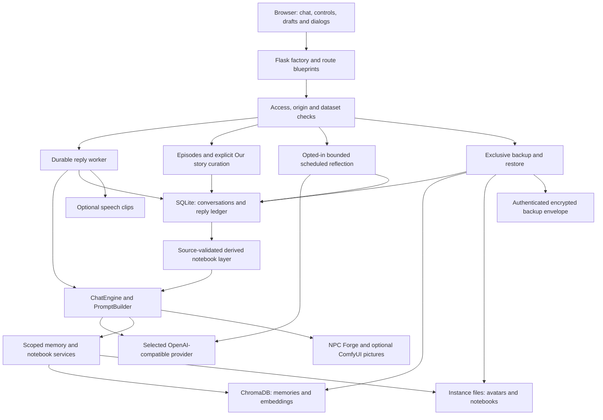

# Altera architecture

Overview reviewed against the working source on 2026-10-28. [plan.md](history/plan.md) records earlier implementation phases. [API reference](API_REFERENCE.md) and [storage schema](Database_Schema.md) describe the corresponding interfaces.

## Runtime and paths

`altera.py` creates the Flask application through `core.app:create_app` and delegates command-line serving to `core.runtime.main`. Normal startup uses one Waitress process with eight threads. `--dev` or `app.debug: true` selects the Flask development server without a reloader. One process per instance is supported: background reply ownership, state leases and maintenance locks are process-local.

`core.runtime.prepare` copies missing starter configuration, loads the instance environment, configures rotating logs, prepares SQLite/FTS and reconciles unfinished replies from an older process. `start_services` performs legacy-companion migration, optional voice autostart and the presence/reflection schedulers once per instance/process. `ALTERA_DISABLE_AUTOSTART=1` disables those startup services; it does not make a production-data test safe by itself because requests can still invoke legacy migration. Stop the previous process before starting its replacement: random process-incarnation recovery identifies interrupted work, not a distributed lock against another live server on the same `ALTERA_HOME`.

`core.paths` distinguishes the source directory (`CODE_ROOT`, containing templates/assets/code) from the instance root. The default instance is the source checkout; `ALTERA_HOME`, set before imports, selects another directory. Database, vectors, avatars, pictures, profile, cache and backup paths belong to that instance. An explicitly supplied relative `DataStore` path still follows the caller's current working directory.

When the command-line server starts listening, it creates `inbox/altera/` and registers its actual listening address in `apps/altera.json` under the per-user Fel's Studio directory. It removes its own registration on graceful shutdown. The WSGI factory leaves listener registration to the host that owns the socket.

## Components

| Area | Source |
| --- | --- |
| Factory, startup, paths, configuration | `core/app.py`, `runtime.py`, `paths.py`, `config.py` |
| Scoped saved-context reports | `core/knowledge_report.py`, `routes/knowledge.py` |
| Voice activity and durable notes | `core/voice_activity.py`, `voice_notes.py`, `routes/voice_notes.py`; browser `voice-activity.js`, `voice-capture-worklet.js`, `voice-notes.js` |
| Chat request validation and controls | `core/routes/core_api.py` |
| Durable ownership, replay, stop and persistence | `core/turns.py` |
| Context, prompts, providers and model calls | `core/chat.py`, `prompts.py`, `llm.py`, `providers.py` |
| SQLite and FTS5 | `core/datastore.py`, `search.py` |
| Vector memory, extraction and deduplication | `core/memory.py`, `local_embeddings.py` |
| Inspectable memory priority and recency | `core/salience.py`, `memory.py`, `routes/knowledge.py` |
| Episodes, curation and recall reservations | `core/episodes.py`, `routes/episodes.py`; browser `story.js` and `/story` |
| Scheduled reflection and derived current notebook | `core/reflection.py`, `routes/reflection.py` |
| Scoped source tracking, corrections and recall boundaries | `core/knowledge.py`, `routes/knowledge.py` |
| Companions and notebook compaction | `core/companions.py`, `notes.py`, `routes/companions.py` |
| Avatar/image integration | `core/companion.py`, `avatars.py`, `photos.py`, `forge.py`, `imagegen.py`, `living.py`, `selfview.py` |
| Character cards and suite handoff | `core/charcard.py`, `characters.py`, `card_inbox.py`, `card_voice.py`, `routes/companions.py` |
| Content gates and adult-mode state | `core/safety.py`, `adult.py`, `age_check.py`, `photo_tags.py` |
| Speech and voice process | `core/tts.py`, `stt.py`, `voice_layer.py`, `voice_service.py` |
| Direct bounded voice HTTP | `core/voice_http.py`, `tts.py`, `voice_service.py`; [startup and transport](VOICE_TRANSPORT.md) |
| State leases and recovery | `core/state_gate.py`, `backups.py`, `routes/backups.py` |
| Authenticated backup envelope | `core/backup_crypto.py`; browser `backups.js`, `backup_dialog.html` |
| Instance-private temporary files | `core/private_paths.py`, `stt.py`, `tts.py`, `routes/backups.py` |
| Explicit setup and supplementary drive inspection | `scripts/setup_altera.py`, `scripts/check_private_storage.py` |
| Access and browser writes | `core/remote_access.py`, `request_security.py`, `csp.py`, `routes/agent_tools.py` |
| Read-only health and reply measurements | `core/health.py`, `diagnostics.py`, `routes/system.py` |
| Legacy engagement and knowledge dashboards | `emotion.py`, `proactive.py`, `relationships.py`, `events.py`, `jokes.py`, `opinions.py`, `templates.py` |
| Frontend | `static/js/`, `static/css/`, `templates/`, `static/sw.js` |

The factory registers 20 blueprints. Pages, sessions, core API, engagement, administration, relationships, personality, search/export, jokes/opinions, providers, workspace tools, avatar integration, companions, backups, knowledge controls, system diagnostics, durable voice notes, presence, episodes and reflection are separate route modules. Health is in `routes/system.py`; keyword mood fallback and bounded speech activity are in `routes/engagement.py`.

## Durable chat

Database initialization selects persistent SQLite WAL mode before publishing the schema. Ordinary connections inherit it, allowing committed-snapshot reads alongside an unfinished background write without attempting a journal-mode transition. This does not remove the existing single-process ownership/maintenance boundary or promise that no SQLite operation can return busy.

The browser submits an 8–100 character request ID along with the message, conversation and current dataset identifier. `TurnService.submit` fingerprints the input and reserves one active reply per session. A duplicate ID with the same input joins/replays existing work; conflicting input or a retired ID is rejected. The worker owns model generation independently of the response stream, so closing the browser does not generate a second reply or discard an already accepted request.

The stream sends `accepted`, response chunks and optional audio/photo/notes events. The terminal result is `saved`, `failed` or `interrupted`. Only `saved` confirms the assistant message ID. SQLite stores request state and replay events; a failed/stopped attempt retains partial text. A durable user or assistant message and its request link commit together; a replacement and its knowledge invalidation share that transaction. On restart, a linked assistant message still present in the same conversation is reported saved, while unfinished work without one is interrupted rather than automatically replayed. Follow-up failures after a confirmed answer do not turn that saved answer into a failed reply. This is SQLite transaction recovery, not a power-loss or hardware-durability guarantee.

For a saved exchange with both message IDs, the reply worker attempts source-checked episodic-recall, memory-recency and expression updates even if a later stream or speech step failed. Each follow-up is independent and failures are logged; these derived updates are not atomic with the saved messages. On normal startup, a surviving episodic reservation from a prior process can be accounted using the saved reply's timestamp after its owner, dataset, sources and original selection are rechecked. Recovery and reservation removal share one transaction; a changed or unavailable source cannot become eligible through recovery.

An eligible durable reply also saves bounded expression and selected-vector-memory recovery intents in the same transaction as the answer. They contain source hashes, selected memory IDs and ownership/boundary metadata, not the conversation text. Normal completion or startup consumes the expression intent atomically with the checked cue update; its saved timestamp governs decay. Vector recency updates recheck the original sources and the current memory, and use each memory's last reply ID to make retry after an uncertain Chroma write idempotent. SQLite and Chroma do not share a transaction; an unsuccessful update remains pending. Startup processes older pending reply IDs first and stops on an uncertain vector failure. If a newer reply already updated a memory before that retry, the older update is skipped to avoid double-counting, so the count can understate recall. Ordinary startup attempts at most 1,000 earlier-process intents of each type per initialization without embedding inference. Editing, forgetting or restoring data clears affected intents. The reply worker also attempts voice-note settlement before releasing its job ownership.

Stop cancels the owned upstream call. Regenerate reuses the original user row and keeps the old assistant text until a replacement succeeds. Message edit/delete and successful replacement retire old replay copies and invalidate derived companion knowledge. Session split/merge preserves message IDs and companion ownership; cross-companion merging is refused. [Memory controls](MEMORY_CONTROLS.md) explains the repair workflow.

Legacy callers without a request ID retain the older synchronous or stream response shape. Those calls do not gain durable replay, Stop ownership or per-request diagnostics. The shipped browser uses durable IDs.

## Context and knowledge

`ChatEngine` selects the session's companion, composes a system prompt from its card and eligible memories/notes, selects recent history, and invokes the configured provider through the OpenAI-compatible SDK. A default-persona chat can use legacy profile/personality features. Imported companions do not inherit another companion's recalled facts.

Vector memories carry an owner plus optional source message IDs and text hashes. Source validity is checked before recall. Legacy untracked or changed-source entries remain inspectable but require review. Manual facts and corrections are explicit assertions, rather than invented source links. Correct/Forget establishes a recall boundary and clears that companion's notes/history so old prompt material cannot immediately restore the fact. Editing a source pauses derived knowledge until repair.

Each companion has `about_you.md` and `our_story.md`. Notebook writes validate the two sections and preserve a bounded history. Updates run periodically after replies or synchronously for context compaction. Fresh notebook evidence uses eligible original user words; assistant replies and generated reflection are excluded so repeating an interpretation cannot independently confirm it. Old notebook text remains a derived aggregate, with user edits and uncertainty preserved. Compaction leaves the visible database conversation intact and omits older messages from future prompts. The context limit comes from explicit configuration, supported provider metadata, or a labeled fallback. Counts use a character heuristic rather than exact tokenization. See [Companions](COMPANIONS.md) and [diagnostic limits](DIAGNOSTICS.md).

The knowledge report builds a deterministic, whitelisted per-companion snapshot while holding the application snapshot gate. It distinguishes recall eligibility from semantic selection and prompt budgeting, exposes current source roles/status/text, and labels notebook lineage as aggregate/incomplete. Report generation does not build chat context, synchronize photos or invoke a model. Global settings and unrelated owners are excluded. Universal personal-evidence rules and notebook-writing instructions preserve uncertainty and distinguish actual exchanges from assistant guesses and imagined scenes.

Voice interruption combines a per-request browser playback latch with owned model cancellation and a separate speech-cancellation event. Saved text remains saved; a running synthesizer retains its writer lease while drain waiting exits promptly. A tab-scoped AudioWorklet monitor sends bounded PCM to installed Silero CPU inference and hands off the same microphone stream with pre-roll. Context/background changes finalize to review or release the monitor; failures disable visibly. Durable voice notes use captured owner/dataset/revision/floor, explicit transcription/review and one immutable turn. Turn completion retains speech files without browser polling. Audio, state and restoration details are in [Voice](VOICE.md).

Legacy relationship, mood, events, jokes, opinions and knowledge-summary APIs remain available. They include instance-wide historical state and should not be mistaken for the companion-scoped provenance API.

## Persistence and recovery

SQLite stores sessions/messages, life events, profile values, durable requests/events, request tombstones, episodes, episodic recall reservations/accounting and reflection preferences/jobs/reports/derived notebooks. FTS5 is an external-content index maintained by insert/update/delete triggers, with a recorded backfill. ChromaDB stores semantic memory documents, metadata, embeddings and pin/salience/recall receipts. Plain files store companion cards, pictures, editable notebooks, profiles, workspace text and preferences. [Database schema](Database_Schema.md) records those boundaries.

Default vector operations use [cached local MiniLM embeddings](LOCAL_EMBEDDINGS.md), preserving Chroma's existing default identity and 384-dimensional vector space. Query/add/update require the six trusted existing ONNX assets, from Chroma's installed cache or `memory.embedding_model_path`; they never download, extract or repair assets during chat. Collection metadata, export and saved-vector restore remain model-free. A missing/incompatible source produces an actionable error rather than selecting another embedding model.

`StateGate` reserves leases for requests and background writers. Backup/restore obtains exclusive access only after active work is idle, then rejects new work. A snapshot includes logical SQLite and vector data plus allowlisted files/preferences. Restore validates an archive, writes a pre-restore recovery backup and imports rows into the application's schema rather than executing uploaded DDL. Failure triggers rollback; interrupted or failed rollback leaves a persistent journal and pauses ordinary access. A changed dataset epoch makes stale browser mutations fail; successful global clearing also rotates the epoch and requires older tabs to reload. Global clear reserves exclusive access, refuses active writers before deletion and surfaces auxiliary cleanup failures instead of claiming a full wipe. Restored drafts require review. See [Backup and restore](BACKUP_AND_RESTORE.md).

Application-wide coordination does not cover another server process or an external program editing instance data. Backup staging additionally takes an operating-system file lock to prevent concurrent archive operations/cleanup on that directory; this does not make the rest of Altera a multi-server application. New backup API requests default to an authenticated encrypted archive, while plaintext ZIP requires an explicit choice. Logs, signing keys and private machine-access settings are excluded from portable archives. Readable report exports remain plaintext and are not a restore format.

## Access and privacy

The default bind is loopback. `remote_access` optionally trusts Tailscale Serve only when the backend connection is loopback, the exact configured host/port matches, the HTTPS proxy header is present and the login is allowed. It does not trust arbitrary forwarded client addresses. This is a private single-owner app, not a public multi-user authorization system.

Unsafe browser requests are checked globally against cross-site fetch metadata and Origin. The legacy proactive GET/HEAD retains strict origin protection but only points to the opted-in presence inbox; polling never generates or speaks. Restored or globally cleared data also requires the current dataset identifier for mutations. CLI clients can omit browser-only headers, so these checks complement the loopback/Tailscale boundary rather than provide local-process authentication.

### Content-Security-Policy

Every HTML page Altera renders has a Content-Security-Policy (`core/csp.py`). Scripts run only from Altera's own `/static` files and from the short start-up scripts in the templates, which carry a nonce made new for each page; there is no `'unsafe-inline'` or `'unsafe-eval'` for scripts. So a script that reached a page some other way, for example through a message or a character card that slipped past escaping, does not run. Inline event handlers would not run either, so pages have none: an element names the global function it calls with `data-click`, `data-change` or `data-submit` (with `data-args` and `data-pass` for arguments), and `static/js/actions.js` calls it from one listener on the document. Nothing in those attributes is evaluated. Styles may still be inline, since the templates and scripts set style attributes. Pictures, speech and recordings come from Altera or from `blob:`/`data:` URLs made in the page; nothing loads from another site, no other site can frame a page, and forms post only to Altera. A response that sets its own policy keeps it. API answers have none, since they are not pages.

Workspace tools restrict file access, exclude private paths and secrets, write only within `workspace/`, limit payload sizes, and reject non-public URL fetches including loopback/private/link-local/shared/Tailscale addresses. DNS is validated at the actual connection and the connection uses the checked numeric addresses while retaining HTTPS hostname/certificate checks. Redirects are revalidated; this fetch surface ignores ambient HTTP(S) proxy environment variables. Model/voice/image services are explicit integrations with separate endpoint configuration.

The PWA caches application assets only. It does not cache private HTML, APIs, generated speech or pictures. IndexedDB drafts still contain private text locally. Local providers keep inference local; cloud providers, Edge speech and web tools send content to their services. There is no automatic chat-provider fallback. The optional speech fallback is visible and blocked in adult mode.

Content text gates run independently of model prompts; the vision age estimate is another heuristic check, not proof of age. Higher picture levels fail closed when the check is unavailable. The adult-mode text instructions depend on model adherence outside the hard code tripwires. [The image guide](AVATARS_AND_ADULT_MODE.md) describes those limits.

## Configuration, diagnostics and verification

`config.yaml` is merged with `config.local.yaml` and supported API-key environment overrides. Both runtime files are ignored by Git; atomic writes additionally keep credentials separated in the local override file. Explicit provider/model selection is shared by chat and helper calls. Startup copies `config.example.yaml` to a missing `config.yaml`, including in a fresh source checkout, without replacing existing settings. The example is the portable starter, not a copy of someone's live settings. The root [quickstart](../README.md) shows setup and checks.

Rotating UTF-8 logs live at `data/altera.log` (5 MiB plus three older files), including local voice child output. Configured credentials are redacted. Keep the logs private. The suite health route returns build metadata. The app's separate health details route performs bounded dependency checks and memory counts without inference. Diagnostics persists per-request timings, actual reported usage, reported OpenRouter credit costs and labeled estimates. Background services and legacy calls are outside its totals.

The checks are pytest with isolated instance paths/fake models, Node frontend logic tests, Ruff and isolated Waitress startup tests. CI defines Windows/Linux runs; a local passing run does not establish a remote CI result or real model/voice/image quality. There is no frontend bundler or native installer build step in this source app.

`scripts/setup_altera.py` is an explicit standard-library setup entry point, with Windows/POSIX wrappers. `--check` reads interpreter/dependency metadata, dependency consistency and configuration mappings; `--dry-run` describes changes without creating files or installing anything. Ordinary explicit setup preserves installed package versions where compatible and copies only missing portable starters; replacements need the separate allow-package-changes option. Offline installation uses a supplied wheelhouse. It does not install Python/model servers, download model weights, launch services or open private conversation/vector stores. Optional provider readiness is a bounded explicitly requested model-list GET, not inference. See [Setup](SETUP.md).

## Durable presence and expression

`presence.py` owns additive preference, ritual, job and inbox tables; `presence_schedule.py` contains pure IANA/UTC scheduling. `routes/presence.py` exposes explicit writes and read-only retrieval. A thirty-second daemon holds no idle lease; planning writes take a short lease and claimed generation uses the selected connection with explicit external-provider consent, one bounded request and no tools/photos/speech/fallback. Owner, source hashes, revisions, recall floor, context fingerprint and dataset identity are checked before publication and again on reads/acceptance. Accepted derived messages retain a source linkage and are filtered from prompts when stale, even if moved by split/merge. Restore pauses preferences and invalidates jobs/inbox. `expression.py` separately stores a simulated tone cue with six-hour intensity decay and source validation; it never stores a second conversation copy or penalizes absence. Browser `presence.js` only polls saved state; `living.js` applies validated expression beneath speech/temporary animation. See [Check-ins and rituals](PRESENCE.md) for controls and limits.

## Episodes, priority and Our story

`episodes.py` stores companion-owned captures of an `actual_exchange`, an `imagined_scene` or a `derived_summary`. Each capture records one or two original message IDs, whole-message UTF-8 SHA-256 hashes and bounded inclusive-start/exclusive-end Unicode character ranges. Excerpts are resolved from canonical current messages on reads. Matching source integrity establishes attribution to saved words; it does not establish that an extracted claim is true or an imagined event happened. Every prompt contribution retains its kind, uncertainty and source attribution. Curation into Our story is an explicit user choice; the view builds on existing conversations, events and notebook foundations without turning a summary into new evidence.

Ordinary captures and corrections require a frozen session/owner/dataset and current revision. Source changes, dirty knowledge, Forget, deletion and restore invalidate recall. A source can follow a same-owner split/merge through stable message IDs only while all current ownership and knowledge checks remain valid. Episode Forget advances the owner's existing knowledge boundary, clears notebook copies and retains a redacted episode tombstone. This prevents a later background run from reconstructing the forgotten entry from retained pre-boundary chat.

`GET /api/episodes/sources` supports deliberate capture through recent-message pickers. This read-only endpoint inspects the newest 60 user/assistant messages in the selected saved conversation after the recall floor, removes blocked/accepted-presence/repair-paused inputs, and returns IDs/roles/saved timestamps with at most 120 Unicode code points of preview. It never opens another conversation or runs a model. The subsequent source review and capture still validate the exact current original text/hash/range; a picker preview is not evidence confirmation.

Relevant episodic recall is occasional: at most two entries, within 1,800 total characters, at most two qualifying uses per UTC day, separated by four other completed exchanges. The durable turn reserves a unique companion/dataset slot before model work. Retrying that turn reconstructs the exact reserved IDs/order after validation instead of reranking later captures. A saved adjacent user/assistant pair spends the budget; a failed or interrupted turn releases its reservation. Read-only preview spends no budget. Correcting an episode while a turn has reserved its evidence is refused, and completion revalidates the captured source snapshot before accounting. These reservations coordinate threads in the supported single-server runtime, not independent server processes.

`salience.py` supplies inspectable priority independent of extraction confidence. Vector recall oversamples eligible candidates and can add bounded relevant pins through lexical matching. Priority combines relevance, salience (1–5), a 30-day half-life with a 0.2 decay floor, and pin status. Pins suspend age decay; they neither verify a claim nor override source eligibility. No decay deletes stored data. Saved successful turns update recency receipts for the selected memories; previews and failed work do not. Episode rankings use the same priority policy. Raising a reflection candidate's pin/salience does not approve it for factual recall; explicit correction or story curation retains its derived label.

## Scheduled reflection and current derived notes

`reflection.py` has separate off-by-default preferences, occurrences/jobs and visible run reports. It reuses the pure IANA quiet-hours policy and the presence provider transport/global inference slot. External consent is specific to reflection and fingerprints the exact provider, endpoint, model and credential identity. Presence/cloud approval cannot be inherited. One run makes at most one 15-second, 1,200-token request, without SDK retries, tools, pictures, speech or fallback. Failed attempts consume the applicable cooldown/daily budget. Idle schedulers hold no lease; planning and generation/publication hold leases so snapshots/restores cannot race a writer.

The source window selects up to eight eligible original user messages from the latest 60 conversation rows, each limited to an exact first-1,000-character range with its saved timestamp. `knowledge.prompt_messages(..., allow_derived=False)` applies the current recall boundary; assistant text, accepted presence, previous reflection, saved episode summaries and editable notebook content never become independent reflection evidence. The provider returns bounded episode candidates and notebook addenda with explicit uncertainty and separate extraction confidence. Before publishing, the same SQLite write transaction rechecks original IDs/hashes/ranges, session/owner, dataset, recall floor, knowledge/preference revisions, consent, quiet hours, expiry and claim identity.

Publication atomically updates the separate SQLite `reflection_notebook` current layer, creates labelled derived episode candidates and saves a report. This is an automatic update to the companion's current derived notes, without replacing the existing editable notebook files. `ChatContext` supplies it to the prompt as a separately labelled derived section and the private report exposes its source provenance. Current reads suppress changed/forgotten/dirty/restored evidence. User edits and dismissals use the existing knowledge mutation guard, wait for active replies, and survive another generated proposal using the same original evidence; prior generated text is never fed back as confirmation. Run reports retain source/result links and resolve current edited notebook entries rather than storing immutable original proposals. Automatic episode candidates require deliberate curation/correction before episodic recall.

Restore retains saved episode curation and reflection records as stale while disabling reflection with a review flag. A user can request a read-only review of retained episode curation, inspect the exact still-current original excerpts, then explicitly revalidate it into the new dataset. Preview and revalidation both check retained text/content safety, labels, priority/confidence and current source integrity. A capture-key collision with newer current-dataset curation returns 409 without replacing either saved record. Revalidation cannot repair changed/missing sources, erase a later Forget floor or invent source links. Old reflection text is not automatically revived: enabling a new run uses only current eligible originals. Source invalidation, companion/session removal and global clear cover the new stores and outstanding jobs.

The `/story` frontend uses explicit scope-bound writes and manual reflection/report refresh; opening the page never starts inference. APIs remain private and `no-store`. Scheduled inference and SQLite claim checks assume the previous server process has stopped before startup recovery; multiple simultaneous servers or outside writers on one instance remain unsupported.

## Encrypted backup envelopes and private staging

The inner logical snapshot is `altera-backup`, version 1. `backup_crypto.py` can wrap it in `altera-encrypted-backup`, version 1, saved as `.alterabak`. Backups made while the app was called Her (`her-backup`, `her-encrypted-backup`, `.herbak`, recovery keys starting `HER-RECOVERY-1-`) are still read. Through pinned PyNaCl/libsodium it uses Argon2id (fixed 64 MiB/three-operation profile), XChaCha20-Poly1305 key wrapping and authenticated secretstream chunks. A fresh archive key and random wrapping parameters belong to each archive. The complete header is authenticated with every frame; a final marker and exact EOF are mandatory. Header/schema/framing/size bounds are checked before the password KDF, and plaintext is published only after complete stream authentication. ZIP path/manifest/schema validation still follows decryption. The codec has local tests and review, not a claimed independent cryptographic audit. See the exact [envelope format](ENCRYPTED_BACKUP_FORMAT.md).

Creation uses a 12-character minimum and 1,024 UTF-8-byte maximum without stripping spaces or normalizing Unicode. An explicitly requested one-time recovery key adds a second independently wrapped way to open that archive. Passwords, raw recovery secrets and unwrapped archive keys are not stored in receipts, ordinary settings, logs or the archive payload/header; encrypted key wrappers and their public parameters are stored. The raw recovery key appears only in the requested create response and can be downloaded deliberately. Lost credentials have no server-held reset or bypass. Archive encryption does not change the live working-store format.

Backup routes validate supported fields/types, one selected source credential, and unambiguous multipart files/form fields. New create and pre-restore recovery requests default to encrypted format, with a separately entered recovery-copy password. Explicit plaintext ZIP is supported for legacy/interchange use; an encrypted source cannot choose plaintext recovery. Unapplied preview/apply operations require the password or recovery key again, including after restart. An interrupted repair uses the existing recovery archive instead of creating another one. A completed service token has a saved private application receipt to prevent duplicate replacement; this is not another method of decrypting an archive. The UI keeps credentials in open inputs, clears them on close and never downloads a recovery key automatically.

Preview retains the uploaded archive bytes unchanged in `.staging/<token>/upload.zip`, so an encrypted input stays encrypted there. Its `.preview-owner.json` marker contains only format/version/token/creation time; `preview.json` records expiry, archive hash, selected connection policy, counts and version, with no unlock credential. Temporary decryption/extraction occurs in private `.work/` directories and is cleaned on ordinary exit. A per-service nonblocking crypto slot bounds concurrent expensive work, and per-directory thread/file locks serialize staging operations and expiry cleanup. Busy operations return 409.

Preview expiry is 15 minutes, which makes an upload eligible for operation-triggered cleanup rather than promising a deletion deadline. Each bounded pass examines at most 100 staging entries; a retained per-service scan cursor advances around preserved unknown entries. Restart resets that cursor and new entries may wait until the next cycle. Cleanup removes only recognized expired token directories containing approved regular files. Linked paths, unknown entries, unsafe permissions, active work and uncertain recovery journals are left untouched. An active restore token is protected; `.work/` recovery material and completed `.results/` receipts are not swept by this TTL mechanism. On POSIX, staging/work/results and restore subdirectories require owner-only 0700 permissions; unsafe existing paths fail rather than being silently repaired. These restrictions are access/confinement controls, not file encryption.

Before replacement, the recovery work directory stores a mandatory readable `protected-settings.yaml` to preserve this PC's credentials and access policy. New `restore-in-progress.json` journals bind it with `protected_settings_sha256`; missing/corrupt/unreadable protection data or a checksum mismatch keeps recovery paused instead of substituting empty settings. Legacy journals can lack the checksum but still require the protection file.

Multipart spooling, STT input and TTS intermediate files use `ALTERA_HOME/data/tmp`. `private_paths.py` rejects linked/junction directories, creates exclusive unpredictable files, closes descriptors before native consumers reopen them, and cleans only its own file identity on exit. TTS publishes completed cache audio through an atomic rename; a custom cache on another volume fails instead of falling back to a plaintext copy. Temp/cache paths are excluded from archives. Crashes, locked native handles or filesystem refusal can leave residue; no general sweep or secure-erasure guarantee is claimed. External service/browser/OS storage remains a separate boundary.
